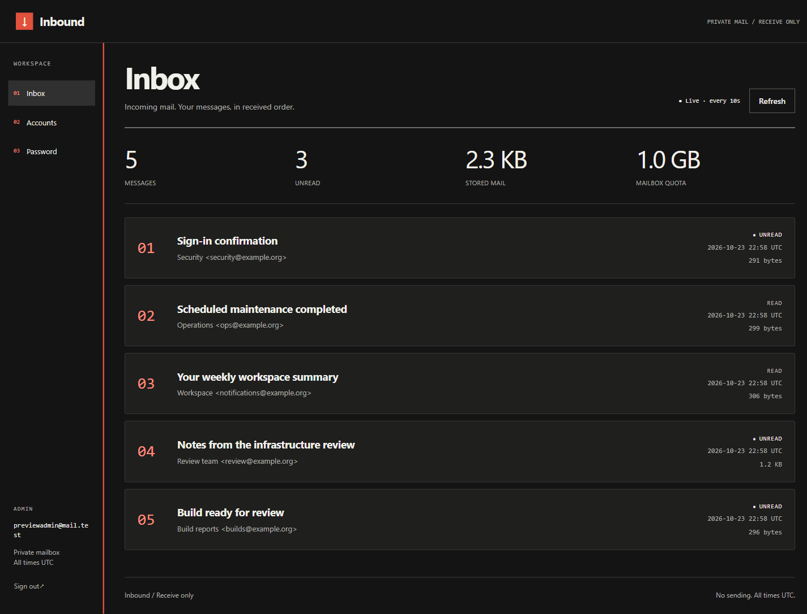

# Inbound

A small, inbound-only mail server with private web mailboxes. Runs as native
services on **Ubuntu 26.04**; other Ubuntu/Debian systems are best-effort.



## Features

- Swiss After Dark UI with automatic inbox refresh, safe HTML previews, and attachments.
- USER and ADMIN accounts, password resets, mailbox quotas, and disk usage.
- All-mail export as original `.eml` files in a tar archive.
- Interactive installer with DNS guidance, HTTPS, and first-admin setup.

No sending, forwarding, IMAP, public signup, search, or folders. Admins can export
everyone's mail. Deletion is permanent; there is no restore or upgrade command.

## Install

Requires root, systemd, Python 3.12+, and inbound TCP 25 and HTTPS access. Automatic
certificate issuance also needs publicly reachable, unoccupied TCP 80.

Run from an interactive terminal (curl must be installed):

```sh
curl -fsSL https://raw.githubusercontent.com/edubovit/inbound-mail/master/install.sh | sudo bash
```

No clone or manual archive download is needed. This runs repository code as root;
download and inspect the script first if you need to review it.
Follow the prompts for your receiving domain, SMTP hostname, UI URL, limits, TLS,
and admin password.
Configure these DNS records using your own domain and IP, **without HTTP proxying**:

```text
example.com.       MX  10 mail.example.com.
mail.example.com.  A   192.0.2.10
```

This receives `user@example.com` without requiring an A record for `example.com`.
The UI can use `https://mail.example.com` or another hostname with its own A record.
The IP above is documentation-only. The installer does not change firewalls
or external proxy routing. See [installation](docs/installation.md) for download
mode, shared hosts, certificates, and external delivery checks.

## Use and configure

Open your HTTPS URL and sign in with your username or full email address.
Admins manage accounts under **Accounts**. Each account has one fixed address.

Edit `/etc/inbound-mail/config.json` as root, then restart the app services:

```sh
sudo systemctl restart inbound-mail-web inbound-mail-smtp
```

Defaults: **25 MiB/message**, **1 GiB/mailbox**, **1 GiB free-disk reserve**.
Individual quotas are editable in Accounts; changing the default affects new
accounts only. See the [configuration reference](docs/configuration.md).

[Operations and recovery](docs/operations.md) · [Security and limits](docs/security.md) ·
[Contributing and development](CONTRIBUTING.md)
