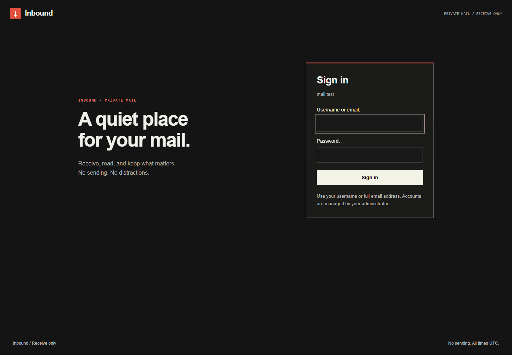

# Swiss After Dark

[User guide](../README.md) · [Development](../CONTRIBUTING.md)

Inbound uses the Grid Rail composition with a **list inbox: one email per row**.
Account management uses a two-column grid, collapsing to one column on narrow
screens. Reading pages and forms remain full-width within the workspace rather
than becoming tiles.

## Visual contract

- Charcoal background `#141414`, bone text `#f1f1eb`, normal entity surface
  `#1f1f1e`, and a 3 px scarlet `#e1513d` navigation boundary.
- Flat surfaces, thin rules, square controls, and at most 3 px entity corners.
  No gradients, glow, decorative movement, or pill-shaped panels.
- Desktop navigation rail is 184 px. At narrow widths it becomes a horizontal
  navigation area with the same active indicator and scarlet boundary.
- Navigation uses tray, people and key outline icons. Mail rows use envelopes,
  not row numbers. Icons are decorative; visible labels and Read/Unread text
  retain their meaning for keyboard and screen-reader users.
- A scarlet square with a bone downward arrow identifies the browser tab. SVG is
  used where supported, with a multi-resolution ICO fallback. Email content still
  cannot load images or external resources inside its sandbox.
- Strong page headings, quiet uppercase labels, and monospace identifiers,
  timestamps and indexes. Login uses Arial, Helvetica, sans-serif explicitly.
- Primary actions are bone with dark text. Scarlet is reserved for identity,
  accents and errors, not every action or unread message.
- Create account sits below the account collection with a 16 px gap. Destructive
  actions are separated and retain their confirmation step.

The exact token definitions are in `mailserver/static/style.css`. Safe HTML email
uses `message.css` inside its sandbox; email-provided styling remains blocked.

## Interaction contract

Mail rows and account tiles expose real links across the non-interactive surface.
Hover lightens the full entity without lifting it, underlining its title, or
changing geometry. Keyboard focus adds a 2 px `#dfc3b8` outline. Modified clicks
retain normal browser navigation. Read state never reorders mail; incoming mail
still appears in received order. Read/unread styling does not change row height.

Pointer hover is limited to hover-capable devices. Only background/border colors
transition; reduced motion disables transitions. High-contrast mode keeps visible
focus and selection indicators.

Single-select forms progressively enhance to a charcoal listbox with scarlet top
rule, taupe active option and selected checkmark. Mouse, touch, arrow/Home/End
keys, Enter/Space, Escape, Tab, type-ahead and outside dismissal are supported.
The original select remains the submitted value and is the no-JavaScript fallback.
Select changes must dispatch input/change events when set programmatically.

Polling status is independent of message state: a refresh error leaves the list
visible and reports a retry. Offline/hidden tabs pause polling. Empty inboxes say
that no messages exist; they do not show synthetic mail or success values. This
application has no monitoring timelines or availability charts.

## Verification

Use the isolated fixture and browser commands in [CONTRIBUTING.md](../CONTRIBUTING.md).
Check login, list, account grid, editors, error confirmations, email content and
attachments at 1440, 768, 390 and 320 px. Include long addresses/subjects, empty
mailboxes, network failure and session expiry. Test both dropdown creation and
editing, as well as the native no-JavaScript fallback.

Screenshots are synthetic and represent the implemented UI. Replace them when
the design changes; do not retain previous designs in this documentation.
