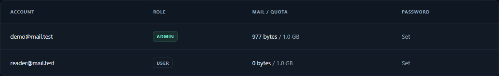

# Using and operating Inbound

[User guide](../README.md) · [Configuration](configuration.md) · [Security](security.md)

## Mailboxes and accounts

Sign in with a username or full address. Inbox updates automatically while the
tab is visible and online; **Refresh** also works without JavaScript. Open a
message to read text, expand **Safe HTML view**, or download attachments. Read
state changes only through **Mark read / Mark unread**. Deletion requires
confirmation and has no Trash or undo.

ADMIN accounts have an **Accounts** page for creating, editing and deleting
accounts, resetting passwords, and viewing storage use. Each account is USER or
ADMIN and has one fixed `username@domain` address. Aliases, catch-all delivery,
multiple receiving domains, address renaming, and public signup are not supported.



Usernames contain 1–64 lowercase ASCII letters, digits, dots, underscores or
hyphens. They start/end with a letter or digit and cannot contain consecutive
dots. Passwords must have at least 12 characters and pass password validation.
Admin-created accounts and reset passwords require a password change on login.
The final administrator cannot be demoted or deleted through the panel.

Deleting an account purges its messages and rejects subsequent delivery to that
address unless it is created again. Admins cannot browse another inbox, but
**all-mail exports expose every account's messages to admins**.

## Service checks

```sh
sudo inbound-mail check
sudo systemctl status inbound-mail-web inbound-mail-smtp
sudo journalctl -u inbound-mail-web -u inbound-mail-smtp
```

The public `/health/` endpoint checks database access and returns `ok`. It is not
an SMTP or external-delivery check. Logs include operational errors and accepted
message sizes/recipient counts, not message bodies. Treat logs as private anyway.

| Location | Owner/purpose |
| --- | --- |
| `/opt/inbound-mail` | Application, virtual environment, installer, TLS refresh tool |
| `/etc/inbound-mail/config.json` | Root-owned production configuration |
| `/var/lib/inbound-mail/mail.sqlite3` | Mail, accounts, sessions, login-attempt state |
| `/etc/nginx/sites-available/inbound-mail` | Owned nginx virtual host |
| `/etc/nginx/sites-enabled/inbound-mail` | Enabled-site symlink |
| `/etc/systemd/system/inbound-mail-{web,smtp}.service` | Application services |
| `/usr/local/bin/inbound-mail` | CLI wrapper with production configuration selected |

Both app services run as `inbound-mail`, with a writable data directory and
read-only application/configuration paths. Each has a 384 MiB systemd memory
limit. They restart on failure; check restart counts and logs if delivery stalls.

## Password recovery

Admins can reset user passwords in Accounts; existing sessions become invalid.
To recover an existing ADMIN account from the server:

```sh
sudo inbound-mail reset-admin admin
```

Substitute the administrator's username. This command prompts securely and
requires another password change after login. It does not create an account or
promote a USER. No recovery emails are sent.

## Export

Use **Accounts → Export all mail**, or the root-only production CLI:

```sh
sudo inbound-mail export /root/mail-export.tar
```

The output path must not already exist. To stream to standard output instead:

```sh
umask 077
sudo inbound-mail export - > mail-export.tar
```

Protect exported mail and keep necessary copies off-server. Shell redirection
creates files with the caller's permissions, hence the restrictive umask.

The archive is an uncompressed tar with one folder per account and one original
`.eml` per message, preserving headers, bodies and MIME attachments. It streams
without staging a complete archive on the VPS. It excludes messages newer than
the export's starting ID cutoff; concurrent deletion can omit messages. Arrange
a maintenance window without delivery or mailbox changes if consistency is needed.

There is **no import or restore command**. Exports do not contain roles, password
hashes, read state or application settings; they are not restorable installation
backups. Automated or remote backups are not configured by the application.

## Storage and certificate care

Watch the Accounts disk figures and host filesystem usage. Mailbox quotas are
ceilings, not reserved capacity. At quota/disk limits, incoming delivery gets
temporary errors; sending servers may eventually give up. There is no automatic
mail expiry or outbound warning email.

For standalone certificate mode:

```sh
sudo systemctl status inbound-mail-renew.timer
sudo journalctl -u inbound-mail-renew.service
```

Certbot logs are under `/var/log/inbound-mail-acme`. Keep TCP 80 reachable and
free for standalone validation. For operator-managed certificates, run the
[refresh tool](installation.md#certificates) after external renewal. Renewal
failures need operator attention; the application sends no alerts.

## Troubleshooting

| Symptom | Checks |
| --- | --- |
| Mail does not arrive | Domain MX/A, SMTP service/listener, host/provider firewalls, and a probe from an independent source network; source-side outbound TCP 25 may be blocked |
| SMTP 550 | Unknown/deleted recipient, wrong domain, or attempted relay |
| SMTP 552 | Whole-message size, including MIME/base64 overhead |
| SMTP 452 | Mailbox quota, disk reserve, recipient limit, or another active DATA transfer |
| SMTP 451 | Delivery rate limit or local processing/database failure; inspect logs |
| SMTP 421 | Concurrent connection limit |
| UI 502 / unavailable | Web service, its loopback port, nginx proxy target, and certificate/SNI routing |
| Inbox says it cannot refresh | Browser connectivity and app health; displayed mail remains until a successful update |
| Login throttled | Wait 15 minutes; counts apply to usernames and source IPs, including successful attempts |
| Browser 403 on form submission | HTTPS origin, expected UI URL, cookies, and trusted proxy headers; do not disable CSRF protection |

## Uninstall

```sh
sudo bash /opt/inbound-mail/install.sh uninstall
```

The script offers export and requires explicit confirmation before purging owned
accounts, mail, configuration, services, nginx integration, and certificates.
Existing external certificates, unrelated services, shared packages, and exports
are retained. Remove obsolete DNS records yourself. Deletion is not a guarantee
of forensic erasure from storage media or provider snapshots.
